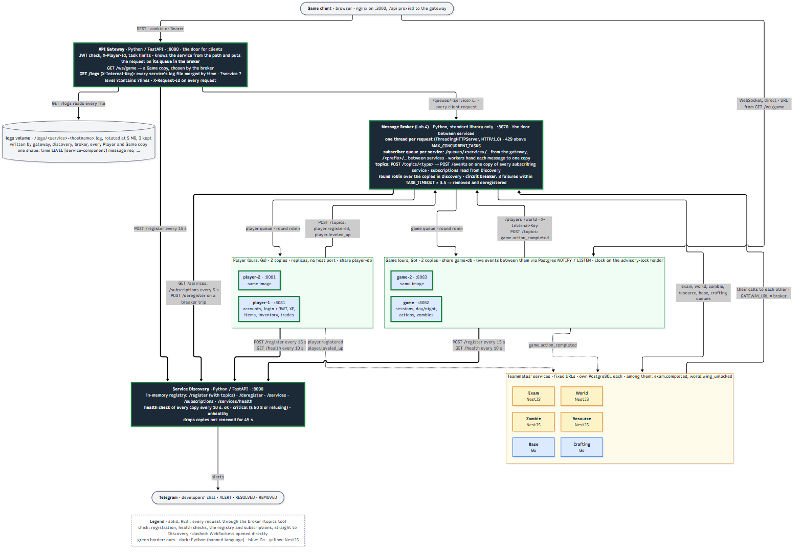

# In Kahoots with the Undead

An educational zombie-survival game set on a university campus, built as microservices
for the PAD lab. Players join sessions, gather resources during the day, and survive
the night: tourist zombies steal, professor zombies give exams.

This is the integration repo. It runs the whole system from published Docker images
and holds our services as git submodules.



## The system

| Component | Owner | Language | Port | Role |
|---|---|---|---|---|
| Gateway | us | Python / FastAPI | 8080 | The door for clients: JWT check, hands each request to the broker's queue for its service, `GET /logs` |
| Message Broker | us | Python, standard library | 8070 | The door between services: a queue per service, topics, round robin, circuit breakers, one thread per request |
| Service Discovery | us | Python / FastAPI | 8090 | Registry of running instances and the topics they subscribe to, health checks, Telegram alerts |
| Player | us | Go / chi | 8081 (2 replicas) | Accounts, login and JWT, XP, items, inventory, trades |
| Game | us | Go / chi + WebSocket | 8082, 8083 (2 copies) | Sessions, day/night clock, timed actions, zombies |
| Exam, World, Zombie, Resource | teammates | NestJS | 8083–8086 | Exams, campus map, zombie types, resources |
| Base, Crafting | teammates | Go | 8087–8088 | Base upgrades, crafting |
| Client | teammates | browser + nginx | 3000 | The game UI |

Three rules hold everywhere:

1. **One door for clients, one for services.** Client REST goes to the gateway,
   which routes on the first path segment (`/auth`, `/players`, `/trades` → Player,
   `/game` → Game, …) and puts the request on the Message Broker's queue for that
   service. Calls between services and events go to the broker directly.
2. **Credentials stop at the door.** The gateway verifies the JWT and passes
   `X-Player-Id` on. Services calling services send `X-Internal-Key` instead.
3. **One database per service.** Others ask over REST or listen for an event.

WebSockets do not pass through the gateway or the broker: `GET /ws/<service>`
returns the URL to connect to directly.

## The Message Broker

```
browser -> gateway -> broker /queues/player/... -> [queue player] -> one player copy
game    ->            broker /players/7        -> [queue player] -> one player copy
player  ->            broker /topics/player.leveled_up -> every subscribing service
```

- **Subscriber-based queues** (gateway → service): the gateway names the service,
  the broker's workers hand each message to one instance, in turn.
- **Topic-based queues** (service → service): a producer publishes without knowing
  who listens; services subscribe when they register with the Service Discovery.
  Player and Game publish their outbox to the broker; Game listens to
  `player.leveled_up`, Player to `game.action_completed`.
- **Load balancing and circuit breakers** moved here from the gateway.
- `GET localhost:8070/health` shows queue depths and published / delivered / lost per topic.

Details: [services/broker_service/README.md](services/broker_service/README.md),
[flow.md](flow.md) sections 3, 4 and 6.

## Running it

```bash
echo "JWT_SECRET=$(openssl rand -hex 32)" > .env   # the only required setting
docker compose up -d --build
```

- Gateway `http://localhost:8080`, client `http://localhost:3000`
- Broker `http://localhost:8070/health`, Discovery `http://localhost:8090/health`
- `DEMO_SPEEDUP=60` in `.env` makes timed actions and day/night take seconds.

Our five images are built from the submodules (`services/*`) until tag `4` is
published on Docker Hub (`fish3008/<repo>:4`). `docker compose down -v` also drops
the databases and the log volume.

## Logs

Every one of our services writes the same line shape, to stdout and to a file on the
shared `logs` volume:

```
2026-11-07T19:37:50Z INFO  [gateway-proxy] POST /auth/register 201 102ms -> player at http://ff2a06725baa:8081 caller=anonymous req=40fc6785d4b0
2026-11-07T19:37:50Z INFO  [player-http] POST /auth/register 201 95ms req=40fc6785d4b0
```

Time in UTC, level, `[service-component]`, message. The gateway gives every request an
`X-Request-Id` (or keeps the caller's), passes it on and returns it, so `req=` links
the lines of one request across services. Health checks and routine re-registrations
are not logged.

**Download them:** `GET /logs` on the gateway, with the `X-Internal-Key` header,
returns one file with every service's lines merged by time:

| Query | Meaning |
|---|---|
| `service=game` | only that service (`gateway`, `discovery`, `broker`, `player`, `game`) |
| `level=WARN` | that level and above |
| `contains=req=40fc6785d4b0` | only matching lines: one request through every service |
| `lines=5000` | the newest N lines (at most 50000) |

```bash
curl -OJ -H "X-Internal-Key: changeme" "http://localhost:8080/logs?level=WARN"
```

## Postman

Run against the whole stack, in Postman or with `npx newman run postman/<file>`:

- `player-service.postman_collection.json`: accounts, players, items, inventory, trades
- `game-service.postman_collection.json`: sessions, actions, rewards, day/night, zombies
  (set `DEMO_SPEEDUP=60`)
- `lab3-scaling.postman_collection.json`: Discovery, round robin, circuit breaker, alerts
- `lab4-broker.postman_collection.json`: the broker's queues and topics (an event end to
  end), and `GET /logs` following one request through gateway, broker and service

## Documentation

- [flow.md](flow.md): how Gateway, Player and Game interact, step by step.
- [communication.md](communication.md): every service's endpoints, events and schemas.
- [lab4_plan.md](lab4_plan.md): the Lab 4 plan (message broker), step by step.
- [architecture.mmd](architecture.mmd): source of `architecture.png`; render with
  `npx -p @mermaid-js/mermaid-cli mmdc -i architecture.mmd -o architecture.png -s 2 -b white`.
- Each service's own README, in `services/<name>/`.
