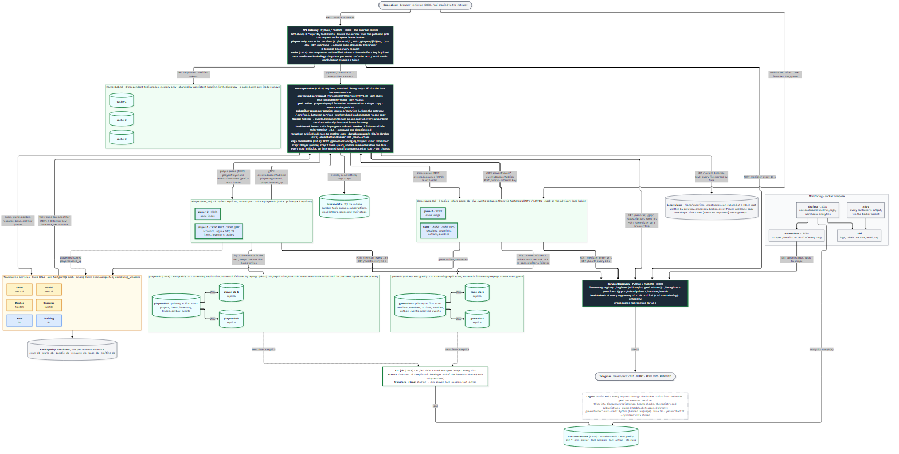

# In Kahoots with the Undead

An educational zombie-survival game set on a university campus, built as microservices
for the PAD lab. Players join sessions, gather resources during the day, and survive
the night: tourist zombies steal, professor zombies give exams.

This is the integration repo. It runs the whole system from published Docker images
and holds our services as git submodules.



## The system

| Component | Owner | Language | Port | Role |
|---|---|---|---|---|
| Gateway | us | Python / FastAPI | 8080 | The door for clients: JWT check, hands each request to the broker's queue for its service |
| Message Broker | us | Python, standard library | 8070 | The door between services: a queue per service, topics, load-based balancing, circuit breakers, durable queues, one thread per request, `GET /logs` |
| Service Discovery | us | Python / FastAPI | 8090 | Registry of running instances and the topics they subscribe to, health checks, Telegram alerts |
| Player | us | Go / chi | 8081 (2 replicas) | Accounts, login and JWT, XP, items, inventory, trades |
| Game | us | Go / chi + WebSocket | 8082, 8083 (2 copies) | Sessions, day/night clock, timed actions, zombies |
| Exam, World, Zombie, Resource | teammates | NestJS | 8083–8086 | Exams, campus map, zombie types, resources |
| Base, Crafting | teammates | Go | 8087–8088 | Base upgrades, crafting |
| Client | teammates | browser + nginx | 3000 | The game UI |
| Cache | us | 3 × Redis | internal | GET answers and verified tokens of the gateway, sharded by consistent hashing |
| `player-db`, `game-db` | us | PostgreSQL + repmgr, 3 nodes each | 5433 (`game-db-0`) | One primary and two replicas, automatic failover |
| Data Warehouse + ETL | us | PostgreSQL + a shell job | 5440 | Analytics: what happened, copied out of Player's and Game's replicas |

Three rules hold everywhere:

1. **One door for clients, one for services.** Client REST goes to the gateway,
   which routes on the first path segment (`/auth`, `/players`, `/trades` → Player,
   `/game` → Game, …) and puts the request on the Message Broker's queue for that
   service. Calls between services and events go to the broker directly.
2. **Credentials stop at the door.** The gateway verifies the JWT and passes
   `X-Player-Id` on. It serves players only: routes for services answer `404`
   there. Services calling services go to the broker with `X-Internal-Key`.
3. **One database per service.** Others ask over REST or listen for an event.

WebSockets do not pass through the gateway or the broker: `GET /ws/<service>`
returns the URL to connect to directly.

## The Message Broker

```
browser -> gateway -> broker /queues/player/... -> [queue player] -> one player copy
game    -> gRPC player.Player/AddXP (:50051)   -> forwarded undecoded -> one player copy
player  -> gRPC events.Broker/Publish          -> events.Consumer/Deliver on every subscriber
```

- **Subscriber-based queues** (gateway → service): the gateway names the service,
  the broker's workers hand each message to one instance, in turn.
- **Topic-based queues** (service → service): a producer publishes without knowing
  who listens; services subscribe when they register with the Service Discovery.
  Player and Game publish their outbox to the broker; Game listens to
  `player.leveled_up`, Player to `game.action_completed`.
- **Load balancing and circuit breakers** moved here from the gateway.
- **gRPC between our services**: Game calls Player (`player.Player`) and both
  publish and receive events (`events.Broker`, `events.Consumer`) over gRPC through
  the broker; the teammates' services keep REST through it.
- **Thread per request**: every HTTP request to the broker runs on a thread of its own.
- `GET localhost:8070/topics` lists every topic, its subscribers and counts;
  `/health` shows queue depths and threads.

Details: [services/broker_service/README.md](services/broker_service/README.md),
[flow.md](flow.md) sections 3, 4, 6 and 11.

## Reliability and monitoring

**Durable queues.** Every event is stored by the broker (SQLite on the
`broker-data` volume) before the producer is answered, one copy per subscribing
service, and deleted only when the subscriber acknowledged it: at-least-once,
and nothing is lost when the broker restarts. Subscriptions are durable: when
every Game copy is down, its `player.leveled_up` events wait and go out when one
is back.

**Dead letter channel.** An event goes there when its subscriber rejects it as
invalid, after 5 failed deliveries (backoff 1, 2, 4, 8 s), or when undelivered
after an hour. `GET localhost:8070/dead-letters` (with `X-Internal-Key`) lists
them with the reason; `POST /dead-letters/<id>/retry` sends one again.

**High availability and load.** The broker sends each message to the instance with
the fewest calls in progress, and reroutes it to another instance when the one it
chose is down or its breaker tripped (a POST only when it never reached the first).
Stop a Player copy in the middle of a run: no client sees an error.

**Monitoring.** `docker compose up` also starts:

| | Where | What |
|---|---|---|
| Grafana | `http://localhost:3001` (no login; `admin`/`admin` to edit) | the *In Kahoots with the Undead* dashboard: instances up, requests and errors per service, latency, broker load per instance, queues, reroutes and breaker trips, events per topic, dead letters, game activity, and the logs |
| Prometheus | `http://localhost:9090` | scrapes `/metrics` on port 9100 of every instance of our five services; which instances exist it asks our Service Discovery (`GET /prometheus`) |
| Loki + Alloy | inside Docker | Alloy reads every container's output (the teammates' too) through the Docker socket and sends it to Loki; our `[service-component]` tag and level become labels |

Metrics ports are not published: players cannot read them.

## Data: replication, cache, warehouse, sagas (Lab 5)

**Replication and failover.** `player-db` and `game-db` are three Postgres nodes each
(`bitnamilegacy/postgresql-repmgr`): one primary streaming its WAL to two read-only
replicas. repmgr runs in every node; when the primary does not answer 3 times, 3 s
apart, a replica is promoted and the other follows it (about 30 s). Player and Game are
given all three hosts (`target_session_attrs=read-write`) and keep the one that takes
writes, so there is no proxy. A stopped primary that is started again joins as a
replica: every node starts through `db/replication/start.sh`, which makes it wait until
its partners agree on the primary, so it cannot come back as a second one.

**Cache.** The gateway keeps the answers of common GETs (`/players/items`,
`/players/{id}`, `/players/{id}/inventory`, `/world/rooms`) and the tokens it verified
in three independent Redis nodes. It picks the node for a key itself, on a consistent
hash ring (100 points per node): adding a fourth node moves 23 % of the keys, where
`hash % N` would move 75 %. A node that fails is skipped for 10 s and only its keys
move to the next node. A change through the gateway drops the keys it made stale.

| Header | Values | Meaning |
|---|---|---|
| `X-Cache` | `HIT`, `MISS` | on a cached route: answered from Redis, or by the service |
| `X-Cache-Node` | `cache-1` … | the node the key lives on |
| `X-Auth-Cache` | `HIT`, `MISS` | the token was known, or its signature was verified |

`POST /auth/logout` (answered by the gateway) revokes the token in the cache until it
would have expired: `200 {"status": "logged_out"}`, then `401` for that token.

**Data Warehouse and ETL.** `warehouse-db` is a separate Postgres. The `etl` container
runs `etl/etl.sh` every 10 s: it copies players, sessions, members and actions out of a
replica of each database (`\copy … TO STDOUT | \copy … FROM STDIN`, read-only
sessions, no password hashes or emails) into staging tables, and `etl/transform.sql`
loads them into a small star schema. Rows deleted in a service stay in the warehouse.

| Table | Columns |
|---|---|
| `dim_player` | `player_id`, `username`, `level`, `xp`, `registered_at`, `loaded_at` |
| `fact_session` | `session_id`, `name`, `host_player_id`, `status`, `cycles`, `players`, `created_at`, `ended_at`, `created_day` |
| `fact_action` | `action_id`, `session_id`, `player_id`, `type`, `room_id`, `status`, `started_at`, `completed_at`, `planned_seconds`, `actual_seconds`, `xp_awarded`, `reward_synced`, `started_day` |
| `etl_runs` | `id`, `started_at`, `finished_at`, `status` (`ok`, `failed`), `players`, `sessions`, `actions`, `error` |

Grafana reads it for the *Analytics* row of the dashboard;
`docker compose exec warehouse-db psql -U warehouse -d warehouse` opens it.

**Sagas.** Joining a session changes two databases: the player's online flag (Player)
and the member row (Game). The broker coordinates it as a saga: it does not forward
`POST /game/sessions/{id}/players`, it runs step 1 on Player and step 2 on Game, writes
every step to its SQLite before and after, and when a step fails undoes the earlier
ones in reverse. A saga interrupted by a broker restart is compensated at the next
start. `GET localhost:8070/sagas` (with `X-Internal-Key`) lists them:

```json
{ "id": "a936cceb-…", "kind": "join-session", "state": "compensated",
  "detail": "step 2 (player takes a seat) failed on game: 409",
  "payload": { "session_id": "…", "player_id": 7 },
  "steps": [
    { "n": 1, "name": "player goes online", "service": "player", "state": "compensated", "status": 204, "kept": { "was_online": true } },
    { "n": 2, "name": "player takes a seat", "service": "game", "state": "failed", "status": 409, "kept": {} } ] }
```

Saga states: `running`, `completed`, `compensating`, `compensated`. Step states:
`pending`, `running`, `done`, `failed`, `unknown` (no answer), `compensating`,
`compensated`. Before the saga this was a two phase commit (Postgres
`PREPARE TRANSACTION`, the broker as coordinator); it is in the git history of the
broker, Player and Game as `grade 8: two phase commit for joining a session`.

Details: [services/gateway_service/README.md](services/gateway_service/README.md)
(cache) and [services/broker_service/README.md](services/broker_service/README.md) (sagas).

## Running it

```bash
echo "JWT_SECRET=$(openssl rand -hex 32)" > .env   # the only required setting
docker compose up -d --build
```

- Gateway `http://localhost:8080`, client `http://localhost:3000`
- Broker `http://localhost:8070/health`, Discovery `http://localhost:8090/health`
- Grafana `http://localhost:3001`, Prometheus `http://localhost:9090`
- `DEMO_SPEEDUP=60` in `.env` makes timed actions and day/night take seconds.

Our five images are published on Docker Hub as `fish3008/<repo>:5`
(`gateway_service`, `broker_service`, `service_discovery`, `player_service`,
`game_service`); `docker compose pull && docker compose up -d` runs them without
building. `--build` builds them from the submodules (`services/*`) instead.
`docker compose down -v --remove-orphans` also drops the databases, the cache, the
warehouse, the log volume and the broker's stored events and sagas.

## Logs

Every one of our services writes the same line shape, to stdout and to a file on the
shared `logs` volume:

```
2026-11-07T19:37:50Z INFO  [gateway-proxy] POST /auth/register 201 102ms -> player at http://ff2a06725baa:8081 caller=anonymous req=40fc6785d4b0
2026-11-07T19:37:50Z INFO  [player-http] POST /auth/register 201 95ms req=40fc6785d4b0
```

Time in UTC, level, `[service-component]`, message. The gateway gives every request an
`X-Request-Id` (or keeps the caller's), passes it on and returns it, so `req=` links
the lines of one request across services. Health checks and routine re-registrations
are not logged.

**Download them:** `GET /logs` on the broker, with the `X-Internal-Key` header,
returns one file with every service's lines merged by time. It is on the broker, the
internal component, because the gateway serves players only:

| Query | Meaning |
|---|---|
| `service=game` | only that service (`gateway`, `discovery`, `broker`, `player`, `game`) |
| `level=WARN` | that level and above |
| `contains=req=40fc6785d4b0` | only matching lines: one request through every service |
| `lines=5000` | the newest N lines (at most 50000) |

```bash
curl -OJ -H "X-Internal-Key: changeme" "http://localhost:8070/logs?level=WARN"
```

## Postman

Run against the whole stack, in Postman or with `npx newman run postman/<file>`:

- `player-service.postman_collection.json`: accounts, players, items, inventory, trades
- `game-service.postman_collection.json`: sessions, actions, rewards, day/night, zombies
  (set `DEMO_SPEEDUP=60`)
- `lab3-scaling.postman_collection.json`: Discovery, round robin, circuit breaker, alerts
- `lab4-broker.postman_collection.json`: the broker's queues and topics (an event end to
  end), `GET /logs` following one request through gateway, broker and service, gRPC and
  the closed gateway, dead letters, and Prometheus / Grafana / Loki
- `lab4-defence.postman_collection.json`: Lab 4, one folder per grade
- `lab5-defence.postman_collection.json`: Lab 5, one folder per grade: the warehouse
  and ETL, replication, the cache (HIT / MISS, invalidation, tokens, logout), sharding,
  and the join saga (completed, compensated, the saga log). Generated from
  `postman/build_lab5_defence.py`.

What needs docker (stopping a database primary, a cache node or the broker in the
middle of a saga) is in `lab5-tests.ps1`: `. .\lab5-tests.ps1`, then
`Show-Replication`, `Test-Failover player`, `Test-CacheNodeDown`, `Show-HashRing`,
`Test-SagaInterrupted`.

## Documentation

- [flow.md](flow.md): how Gateway, Player and Game interact, step by step.
- [communication.md](communication.md): every service's endpoints, events and schemas.
- [lab4_plan.md](lab4_plan.md): the Lab 4 plan (message broker), step by step.
- [lab5_plan.md](lab5_plan.md): the Lab 5 plan (replication, cache, sagas), step by step.
- [architecture.mmd](architecture.mmd): source of `architecture.png`; render with
  `npx -p @mermaid-js/mermaid-cli mmdc -i architecture.mmd -o architecture.png -s 2 -b white`.
- Each service's own README, in `services/<name>/`.
